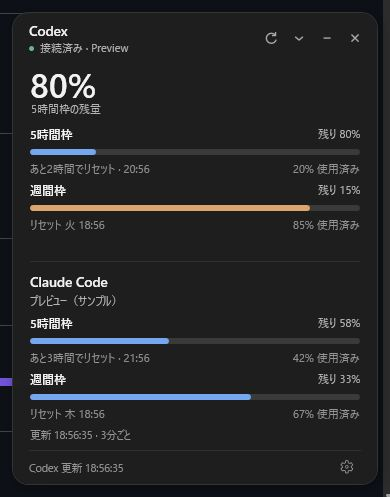
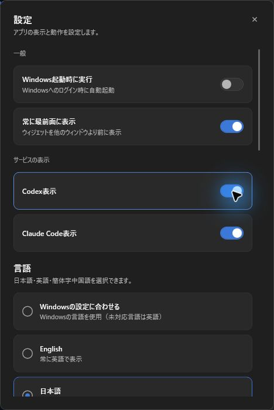

# Agent Usage Widget

Windows上でCodexとClaude Codeの利用枠を同時に確認するアプリです。
[ognjeeen/codex-usage-widget](https://github.com/ognjeeen/codex-usage-widget)をForkして拡張しました。
元のMITライセンス・著作権表示は保持しています。各サービスの非公式アプリです。



## 起動方法

1. `artifacts/release/agent-usage-widget-win-x64.zip`を展開します。
2. `AgentUsageWidget.exe`を起動します。.NETランタイムは同梱されています。
3. 歯車の「設定」から言語、自動起動、最前面表示を選択します。

ポータブル版です。自動起動を使う場合は、展開先を移動しないでください。
このForkの改修版はローカルで作成したもので、GitHub Releasesにはまだ公開していません。

## 機能

- CodexとClaude Codeの5時間枠・週間枠を1画面に表示。
- 使用率、残量、リセット時刻を表示。取得できない枠を0%として表示しません。
- システムトレイに常駐。クリックで開き、右クリックで更新・設定・終了。
- 「Windows起動時に実行」で、Windowsへのログイン時に自動起動。
- 「常に最前面に表示」をオン／オフ。デスクトップウィジェットに適用されます。
  オンの場合、タスクバーやトレイから開いたウィジェットも、他のアプリに切り替えたときに表示を維持します。
- 日本語／英語を再起動なしで切替。Windowsの言語に合わせる設定もあります。
- 設定の「Codex表示」「Claude Code表示」で個別に表示を切替。再起動後も保持します。
  両方オフの場合は設定から再表示できます。表示を隠しても自動更新は継続します。
- Codexは2分ごと、Claudeは3分ごとに自動更新。更新ボタンは両方を更新。
- Claudeの取得失敗時は、最後に取得した値を明示して残します。



`−`ボタンでウィジェットを隠し、Codexの小さなタスクバー表示に移動します。
トレイのツールチップにはCodexの選択中の残量とClaudeの使用率を表示します。
タスクバーの小表示とトレイアイコンの数値はCodex用です。両サービスの全利用枠はメイン画面で確認できます。
`×`ボタンはアプリを終了します。

## サービスとの接続

### Codex

Codex CLIをインストールし、`codex login`でログインしてください。
`codex --version`がPowerShellで動く必要があります。
別の場所にインストールした場合は`CODEX_USAGE_WIDGET_CODEX_PATH`で`codex.cmd`または`codex.exe`を指定できます。
公式のローカルapp-serverを介して利用枠を取得し、Codexの認証ファイルを直接読み取りません。

### Claude Code

Windows側のClaude Codeで`/login`を実行してください。
既存の`%USERPROFILE%\.claude\.credentials.json`のOAuthログインを読み取り、
Anthropicの`https://api.anthropic.com/api/oauth/usage`に取得リクエストを送ります。
保存先が違う場合は`USAGE_WIDGET_CLAUDE_CREDENTIALS`に認証ファイルのパスを指定できます。

認証ファイルは読み取り専用です。トークンの更新・書き戻しは行いません。
期限切れ時はClaude Code側でログインを更新し、アプリを更新してください。
リクエスト制限時は`Retry-After`に従って待機します。手動更新でも待機時間は短縮しません。
CLIの認証・Anthropicの利用枠取得インターフェースに依存するため、サービス側の変更で修正が必要になる場合があります。
WSLのみのログインやAPIキー課金の利用量には対応していません。

片方のサービスが未設定でも、もう片方は独立して動作します。
ログイン操作はユーザーが各CLIで行います。アプリはAIへの質問やメッセージ生成を実行しません。

## 既存Codex専用版との共存

設定・ログは`%LOCALAPPDATA%\AgentUsageWidget`に保存します。
自動起動の登録名、二重起動防止、動作表示用の通信先も元のアプリと分けています。
元の`%LOCALAPPDATA%\CodexUsageWidget`や自動起動設定は変更しません。
Codexの動作表示用フックは任意で、通常の起動時には追加しません。

## 開発・検証

リポジトリの`global.json`で指定された.NET SDKが必要です。

```powershell
dotnet restore .\CodexUsageWidget.slnx
dotnet build .\CodexUsageWidget.slnx -c Release --no-restore
dotnet test .\CodexUsageWidget.slnx -c Release --no-build
.\scripts\publish.ps1 -Runtime win-x64
```

サンプルデータだけで画面を確認する場合：

```powershell
dotnet run --project .\src\CodexUsageWidget\CodexUsageWidget.csproj -p:EnableUsagePreview=true -- --preview-usage
```

プレビューはCodex・Claudeの認証や利用枠取得を行わず、自動起動の変更もメモリ内で再現します。
画面の言語・最前面などの設定は通常の設定保存先を使用します。

## 削除

設定で自動起動をオフにし、追加した動作表示用フックがあれば削除してから終了してください。
展開したフォルダと`%LOCALAPPDATA%\AgentUsageWidget`を削除します。

## 検証状況

2026-10-11：Windows上でサンプルによる両サービス表示、日英の即時切替、最前面設定の保存を確認。
多画面・DPI設定の変更・Windows再起動による自動起動確認は未実施です。
Claudeの実アカウントでの取得は、ローカルログインがある環境で確認が必要です。
